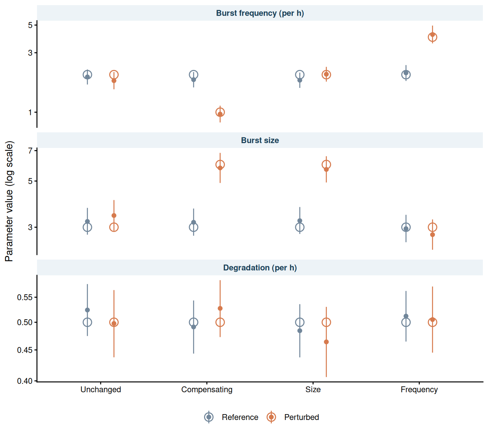
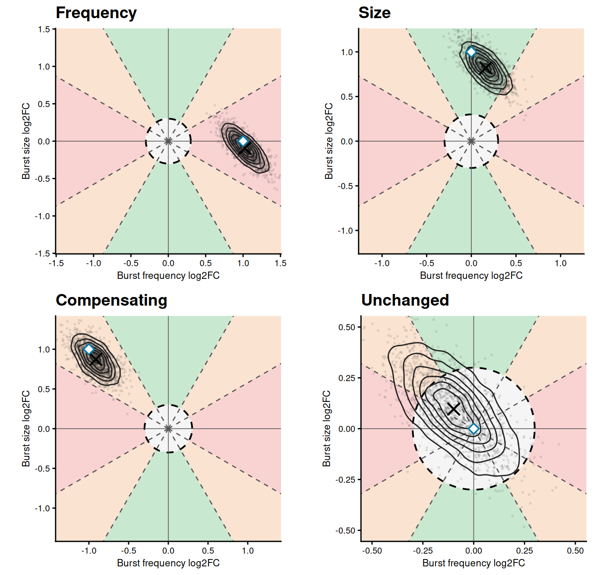

```{r setup, include=FALSE}
run_fits <- identical(Sys.getenv("BURST_VIGNETTE_RUN_FITS"), "true")
knitr::opts_chunk$set(
  collapse = TRUE, comment = "#>", message = FALSE,
  fig.width = 7.4, fig.height = 4.6, fig.align = "center", dpi = 144
)
```

<!-- <nav class="tutorial-nav" aria-label="buRst vignettes"> -->
<!-- <a href="bursting_same_mean.html">Count distributions</a> -->
<!-- <a href="simulation.html">Simulate counts</a> -->
<!-- <a href="acute_pertubation.html" aria-current="page">Acute perturbation</a> -->
<!-- <a href="inference.html">Fit scSLAM-seq data</a> -->
<!-- </nav> -->

Two simulated genes double their RNA synthesis after a perturbation. One
doubles burst frequency and the other doubles burst size. A third gene changes
both in opposite directions, and a fourth serves as an unchanged control.
Use the joint estimates of frequency and size to distinguish these patterns.

> The count simulation runs when this vignette renders. The fit section shows
> recorded results from one run with buRst 0.1.1. To recompute them, run the
> steps below in order in R, or set `BURST_VIGNETTE_RUN_FITS=true` in the
> environment before rendering this Rmd. The fitting workflow generates its
> own inputs and uses temporary files.

## 1. Set the ground truth

All four genes start in steady state with the same burst frequency (`km`),
mean burst size (`B`), and degradation rate (`d`). We label both groups for
one hour. In the perturbed group, labeling and the change in kinetics start
together.

```{r packages}
library(buRst)
library(grandR)
library(ggplot2)
```

```{r settings}
settings <- list(
  n_cells = 500L,
  t_label = 1,
  ndraw = 6000L,
  seed_reference = 101L,
  seed_perturbed = 102L,
  seed_reads_reference = 103L,
  seed_reads_perturbed = 104L,
  seed_fit = 105L,
  seed_comparison = 106L,
  p_old = 1e-4,
  p_new = 0.04
)
```

```{r figure-style, include=FALSE}
condition_colors <- c(Reference = "#71869A", Perturbed = "#D67A4D")
gene_colors <- c(
  Frequency = "#287D8E", Size = "#B96445",
  Compensating = "#8B6DA7", Unchanged = "#7C8792"
)
example_theme <- theme_classic(base_size = 11) +
  theme(
    plot.title = element_text(face = "bold", color = "#183e56"),
    strip.background = element_rect(fill = "#edf3f7", color = NA),
    strip.text = element_text(face = "bold", color = "#183e56"),
    legend.position = "bottom", legend.title = element_blank(),
    plot.caption = element_text(hjust = 0, color = "#5d7181")
  )
```

```{r truth}
truth <- data.frame(
  gene = c("Frequency", "Size", "Compensating", "Unchanged"),
  km_reference = 2,
  B_reference = 3,
  d_reference = 0.5,
  km_perturbed = c(4, 2, 1, 2),
  B_perturbed = c(3, 6, 6, 3),
  d_perturbed = 0.5,
  stringsAsFactors = FALSE
)
truth$lfc_km <- with(truth, log2(km_perturbed / km_reference))
truth$lfc_B <- with(truth, log2(B_perturbed / B_reference))
truth$lfc_synthesis <- truth$lfc_km + truth$lfc_B

knitr::kable(
  truth[, c("gene", "lfc_km", "lfc_B", "lfc_synthesis")],
  col.names = c("Example gene", "Frequency log2FC", "Size log2FC", "Synthesis log2FC"),
  digits = 2
)
```

The mean synthesis rate is `km * B`. The Frequency and Size genes both
double this product. Their expected total RNA trajectories overlap, and by
one hour neither has reached its new steady-state mean. The Compensating
gene keeps the same mean synthesis rate and can still change its count
distribution.

```{r trajectories, echo=FALSE, fig.cap="Expected total RNA after perturbation. The vertical line marks sampling at one hour. The horizontal dashed line marks the new steady-state mean."}
trajectory <- do.call(rbind, lapply(seq_len(nrow(truth)), function(i) {
  z <- truth[i, ]
  time <- seq(0, 6, length.out = 151)
  m0 <- z$km_reference * z$B_reference / z$d_reference
  target <- z$km_perturbed * z$B_perturbed / z$d_perturbed
  data.frame(
    gene = z$gene, time = time,
    mean = target + (m0 - target) * exp(-z$d_perturbed * time),
    steady_mean = target
  )
}))
trajectory$gene <- factor(trajectory$gene, levels = truth$gene)
ggplot(trajectory, aes(time, mean, color = gene)) +
  geom_hline(data = unique(trajectory[c("gene", "steady_mean")]),
             aes(yintercept = steady_mean), linetype = 2,
             color = "grey70", linewidth = 0.4) +
  geom_vline(xintercept = settings$t_label, linetype = 3, color = "grey45") +
  geom_line(linewidth = 0.9) +
  facet_wrap(~gene, ncol = 2) +
  scale_color_manual(values = gene_colors, guide = "none") +
  labs(x = "Time after perturbation (h)", y = "Expected total RNA per cell") +
  example_theme
```

## 2. Simulate cells before and after the change

Draw the reference cells in steady state. Use their total counts as `init`
for the transient simulation, where they supply the RNA already present at
labeling onset.

```{r simulate-reference}
reference <- simulateBursting(
  kms = truth$km_reference, Bs = truth$B_reference,
  ds = truth$d_reference, gene.info = truth$gene,
  t.end = settings$t_label, no.cells = settings$n_cells,
  condition = "Reference", tp.label = 0,
  steady = TRUE, ntr.sim = FALSE, parallel = FALSE,
  seed = settings$seed_reference, on_gene_error = "stop"
)
reference_total <- as.matrix(GetMatrix(reference, mode.slot = "count"))
stopifnot(identical(rownames(reference_total), truth$gene))
```

```{r simulate-perturbation}
perturbed <- simulateBursting(
  kms = truth$km_perturbed, Bs = truth$B_perturbed,
  ds = truth$d_perturbed, gene.info = truth$gene,
  t.end = settings$t_label, no.cells = settings$n_cells,
  condition = "Perturbed", tp.label = 1,
  steady = FALSE, init = reference_total,
  ntr.sim = FALSE, parallel = FALSE,
  seed = settings$seed_perturbed, on_gene_error = "stop"
)

for (x in list(reference, perturbed)) {
  stopifnot(all(
    as.matrix(GetMatrix(x, mode.slot = "count")) ==
      as.matrix(GetMatrix(x, mode.slot = "new")) +
      as.matrix(GetMatrix(x, mode.slot = "old"))
  ))
}
```

```{r count-data, echo=FALSE}
count_rows <- function(x, condition) {
  do.call(rbind, lapply(c("count", "new"), function(slot) {
    mat <- as.matrix(GetMatrix(x, mode.slot = slot))
    data.frame(
      gene = rep(rownames(mat), each = ncol(mat)),
      condition = condition,
      measurement = if (slot == "count") "Total RNA" else "New RNA",
      count = as.vector(t(mat))
    )
  }))
}
count_df <- rbind(count_rows(reference, "Reference"),
                  count_rows(perturbed, "Perturbed"))
count_df$gene <- factor(count_df$gene, levels = truth$gene)
count_df$condition <- factor(count_df$condition, levels = names(condition_colors))
count_df$measurement <- factor(count_df$measurement, levels = c("Total RNA", "New RNA"))
```

```{r count-plot, echo=FALSE, fig.height=5.7, fig.cap="True molecule counts by condition. Each box summarizes the distribution across 500 simulated cells. The next step adds uncertainty about which molecules are new."}
ggplot(count_df, aes(condition, count, fill = condition)) +
  geom_boxplot(width = 0.55, outlier.size = 0.35, outlier.alpha = 0.3) +
  facet_grid(measurement ~ gene, scales = "free_y") +
  scale_fill_manual(values = condition_colors, guide = "none") +
  labs(x = NULL, y = "True RNA molecules per cell") +
  example_theme + theme(axis.text.x = element_text(angle = 30, hjust = 1))
```

## 3. Generate the inputs for fitting

`SimulateReads()` creates conversion evidence for each group. Merge the
`grandR` objects for counts and metadata, then merge the two `.targets`
directories for the discrete labeling likelihoods. Distinct condition names
give the two groups distinct cell IDs.

```{r labeling-evidence, eval=run_fits}
work_dir <- tempfile("buRst_acute_perturbation_")
dir.create(work_dir)
reference_prefix <- file.path(work_dir, "reference")
perturbed_prefix <- file.path(work_dir, "perturbed")

reference_reads <- SimulateReads(
  reference, output_prefix = reference_prefix,
  p.old = settings$p_old, p.new = settings$p_new,
  fit.beta = FALSE, burstMCMC = FALSE, parallel = FALSE,
  seed = settings$seed_reads_reference
)
perturbed_reads <- SimulateReads(
  perturbed, output_prefix = perturbed_prefix,
  p.old = settings$p_old, p.new = settings$p_new,
  fit.beta = FALSE, burstMCMC = FALSE, parallel = FALSE,
  seed = settings$seed_reads_perturbed
)
```

```{r merge-inputs, eval=run_fits}
sim_data <- merge(reference_reads, perturbed_reads)
combined_targets <- file.path(work_dir, "combined.targets")
merge_targets_dirs(
  targets1 = paste0(reference_prefix, ".targets"),
  targets2 = paste0(perturbed_prefix, ".targets"),
  output_targets = combined_targets,
  h5_filename = "4sU.Binom.discrete.h5",
  overwrite = FALSE
)
h5_path <- file.path(combined_targets, "4sU.Binom.discrete.h5")
stopifnot(file.exists(h5_path))
table(Coldata(sim_data)$Condition)
```

## 4. Fit both conditions and check the diagnostics

Fit the reference at steady state and use it to initialize the transient fit
with `fit2_ref_cond = "Reference"`. Set `t.diff` equal to `t.label` because
the transient model follows the population from the start of labeling.
`run_kinetics_fits()` retains the paired frequency and size draws within each
condition for the comparison.

```{r fit-kinetics, eval=run_fits}
fits <- run_kinetics_fits(
  data = sim_data, genes = truth$gene,
  cond1 = "Reference", cond2 = "Perturbed",
  t.label = settings$t_label, t.diff = settings$t_label,
  fit1_steady = TRUE, fit2_steady = FALSE,
  fit2_ref_cond = "Reference",
  h5_path = h5_path,
  ndraw = settings$ndraw, seed = settings$seed_fit,
  parallel = FALSE, timeout_sec = 300, verbose_every = 1
)
```

```{r diagnostics, eval=run_fits, results="asis"}
print(knitr::kable(fits$fit_meta[, c("gene", "fit_cond", "ok", "error")]))
if (nrow(fits$fits)) {
  cat("\n\n")
  print(knitr::kable(fits$fits[, c("gene", "fit_cond", "conv", "id_flag")]))
}
```

In the recorded run, all eight fits completed with `conv = 0` and
`id_flag = "ok"`. For a new run, check `fit_meta` for errors and inspect
`conv` and `id_flag` in both conditions. The example comparison below skips
fits with nonzero convergence codes, `bad_hessian` or `strong_tradeoff`
flags, or too few usable draws.

```{r recovery-snapshot, eval=!run_fits, echo=FALSE, fig.cap="Recorded parameter recovery. Open circles mark simulation truth. Filled points and bars show medians and 95% intervals from local Laplace draws."}

```

```{r recovery-table, eval=run_fits, echo=FALSE}
recovery <- do.call(rbind, lapply(c("km", "B", "d"), function(parameter) {
  z <- fits$fits
  if (!nrow(z)) return(NULL)
  true_reference <- truth[[paste0(parameter, "_reference")]][match(z$gene, truth$gene)]
  true_perturbed <- truth[[paste0(parameter, "_perturbed")]][match(z$gene, truth$gene)]
  data.frame(
    gene = z$gene, condition = z$fit_cond,
    parameter = parameter,
    median = z[[paste0(parameter, "_med")]],
    lower = z[[paste0(parameter, "_lo")]],
    upper = z[[paste0(parameter, "_hi")]],
    truth = ifelse(z$fit_cond == "Reference", true_reference, true_perturbed)
  )
}))
if (!is.null(recovery)) {
  recovery <- subset(recovery, is.finite(median) & is.finite(lower) &
                       is.finite(upper) & lower > 0 & median > 0 & upper > 0)
}
```

```{r recovery-plot, eval=run_fits, echo=FALSE, fig.height=6.6, fig.cap="Open circles mark simulation truth. Filled points and bars show medians and 95% intervals from local Laplace draws."}
if (!is.null(recovery) && nrow(recovery)) {
  recovery$gene <- factor(recovery$gene, levels = rev(truth$gene))
  recovery$condition <- factor(recovery$condition, levels = names(condition_colors))
  recovery$parameter <- factor(recovery$parameter, levels = c("km", "B", "d"),
                              labels = c("Burst frequency (per h)", "Burst size", "Degradation (per h)"))
  pd <- position_dodge(width = 0.5)
  print(ggplot(recovery, aes(gene, median, color = condition, group = condition)) +
    geom_linerange(aes(ymin = lower, ymax = upper), position = pd, linewidth = 0.5) +
    geom_point(position = pd, size = 1.8) +
    geom_point(aes(y = truth), position = pd, shape = 1, size = 3.8, stroke = 0.8) +
    facet_wrap(~parameter, ncol = 1, scales = "free_y") +
    scale_y_log10() + scale_color_manual(values = condition_colors) +
    labs(x = NULL, y = "Parameter value (log scale)") + example_theme)
} else {
  cat("No finite positive parameter intervals are available. Inspect fit_meta above.")
}
```

## 5. Compare changes in frequency and size

Each dot shows a pair of log2 fold changes, **Perturbed / Reference**.
The blue diamond marks the known change. Read the cloud against the diamond
and check the change and attribution fields before assigning a mechanism.

```{r cloud-snapshot, eval=!run_fits, echo=FALSE, fig.cap="Recorded joint comparisons. Blue diamonds show the known changes. The Frequency and Size genes separate along different axes, while the Compensating gene changes along both."}

```

| Example gene | True frequency log2FC | True size log2FC | Fitted median frequency | Fitted median size | Supported conclusion |
|---|---:|---:|---:|---:|---|
| Frequency | +1 | 0 | +1.02 | −0.09 | Frequency |
| Size | 0 | +1 | +0.16 | +0.82 | Size |
| Compensating | −1 | +1 | −0.91 | +0.87 | Both, in opposing directions |
| Unchanged | 0 | 0 | −0.10 | +0.10 | No supported change |

These are the results from the recorded run (R 4.3.3, buRst 0.1.1, grandR 0.2.7).
For the unchanged gene, the comparison returned `top_mechanism = "Both"`
but `call_change = FALSE`. Check `call_change` first, then `attrib_ok` and
`mechanism_supported`. Report a failed fit separately from a completed
comparison without a supported change. Four synthetic genes illustrate how
to read the output. Estimating accuracy requires repeated simulations.

### Recompute the comparisons

This check keeps the diagnostics visible even when a pair is excluded from
the comparison. If you run the example in R, inspect
`comparisons[["Frequency"]]$plot` for the frequency responder.

```{r check-fit-pairs, eval=run_fits}
fit_is_usable <- function(z) {
  if (is.null(z) || !is.data.frame(z) || !nrow(z)) return(FALSE)
  required <- c("conv", "id_flag")
  if (!all(required %in% names(z))) return(FALSE)
  draws <- attr(z, "samples")
  if (!is.list(draws) || !all(c("km", "B") %in% names(draws))) return(FALSE)
  valid <- is.finite(draws$km) & draws$km > 0 &
    is.finite(draws$B) & draws$B > 0
  isTRUE(z$conv[1] == 0) &&
    (is.na(z$id_flag[1]) || !z$id_flag[1] %in% c("bad_hessian", "strong_tradeoff")) &&
    sum(valid) >= 100L
}
pair_ok <- vapply(truth$gene, function(gene) {
  pair <- fits$fit_objects[[gene]]
  fit_is_usable(pair[["Reference"]]) && fit_is_usable(pair[["Perturbed"]])
}, logical(1))
knitr::kable(data.frame(gene = truth$gene, interpretable_pair = unname(pair_ok)))
```

```{r compare-posteriors, eval=run_fits}
comparisons <- setNames(lapply(seq_len(nrow(truth)), function(i) {
  gene <- truth$gene[i]
  if (!pair_ok[i]) return(NULL)
  pair <- fits$fit_objects[[gene]]
  compare_posteriors_gate_star_kmB(
    res1 = pair[["Reference"]], res2 = pair[["Perturbed"]],
    gene = gene, seed = settings$seed_comparison + i,
    plot = TRUE, max_plot_points = 1500, grid_n = 120
  )
}), truth$gene)
```

```{r posterior-clouds, eval=run_fits, echo=FALSE, fig.height=7.4, fig.cap="Recomputed joint comparisons. Blue diamonds mark simulation truth."}
clouds <- lapply(seq_len(nrow(truth)), function(i) {
  gene <- truth$gene[i]
  cmp <- comparisons[[gene]]
  if (is.null(cmp)) {
    return(ggplot() + annotate("text", x = 0, y = 0,
      label = "Fit unavailable or diagnostics failed", size = 3.1) +
      labs(title = gene) + theme_void() +
      theme(plot.title = element_text(face = "bold")))
  }
  cmp$plot +
    geom_point(data = data.frame(x = truth$lfc_km[i], y = truth$lfc_B[i]),
               aes(x, y), inherit.aes = FALSE,
               shape = 23, fill = "white", color = "#087CA7", size = 3, stroke = 1) +
    labs(title = gene, subtitle = NULL, caption = NULL,
         x = "Burst frequency log2FC", y = "Burst size log2FC") +
    theme(plot.title = element_text(face = "bold"),
          axis.title = element_text(size = 9), axis.text = element_text(size = 8),
          legend.position = "none", aspect.ratio = 1)
})
grid::grid.newpage()
grid::pushViewport(grid::viewport(layout = grid::grid.layout(2, 2)))
for (i in seq_along(clouds)) {
  print(clouds[[i]], newpage = FALSE,
        vp = grid::viewport(layout.pos.row = (i - 1L) %/% 2L + 1L,
                            layout.pos.col = (i - 1L) %% 2L + 1L))
}
grid::popViewport()
```

```{r mechanism-table, eval=run_fits}
summary_rows <- lapply(names(comparisons), function(gene) {
  cmp <- comparisons[[gene]]
  if (is.null(cmp)) return(NULL)
  row <- cmp$summary
  row$gene <- gene
  row
})
summary_rows <- Filter(Negate(is.null), summary_rows)
comparison_summary <- if (length(summary_rows)) do.call(rbind, summary_rows) else data.frame()

if (nrow(comparison_summary)) {
  wanted <- c("gene", "call_change", "attrib_ok", "top_mechanism", "mechanism_supported",
              "median_lfc_km", "median_lfc_B")
  knitr::kable(comparison_summary[, wanted], digits = 2)
} else {
  cat("No interpretable posterior comparisons; inspect the fit diagnostics.")
}
```

## Save a portable copy

To refit later, save the merged `grandR` object and its complete
`combined.targets` directory together. Save the fits separately if you want
to inspect the results without refitting.

```{r export-example, eval=FALSE}
example_dir <- file.path(getwd(), "acute_perturbation_example")
if (dir.exists(example_dir)) stop("Choose a new example_dir to avoid overwriting files.")
dir.create(example_dir, recursive = TRUE)
stopifnot(file.copy(combined_targets, example_dir, recursive = TRUE))

saveRDS(
  list(data = sim_data, truth = truth, settings = settings,
       h5_relative = "combined.targets/4sU.Binom.discrete.h5"),
  file.path(example_dir, "simulated_input.rds")
)
saveRDS(
  list(fits = fits, comparison_summary = comparison_summary,
       comparisons = comparisons, settings = settings, truth = truth),
  file.path(example_dir, "fitted_results.rds")
)
writeLines(capture.output(sessionInfo()), file.path(example_dir, "sessionInfo.txt"))
```

When you reopen the example, resolve the HDF5 path relative to that folder.

```{r reuse-example, eval=FALSE}
example_dir <- "path/to/acute_perturbation_example"
input <- readRDS(file.path(example_dir, "simulated_input.rds"))
saved <- readRDS(file.path(example_dir, "fitted_results.rds"))
h5_path <- file.path(example_dir, input$h5_relative)
stopifnot(file.exists(h5_path))
saved$comparison_summary
# Refit with input$data, input$truth$gene, and this reconstructed h5_path.
```

**Continue with** the [inference guide](inference.html) to apply this workflow
to processed scSLAM-seq data.
